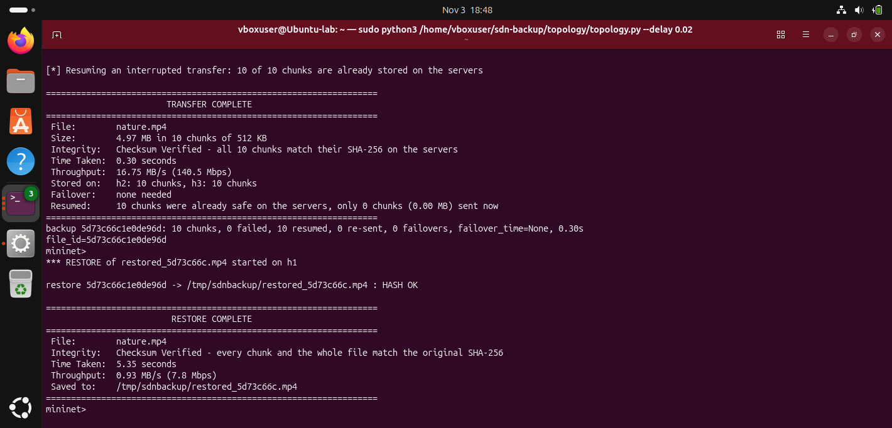
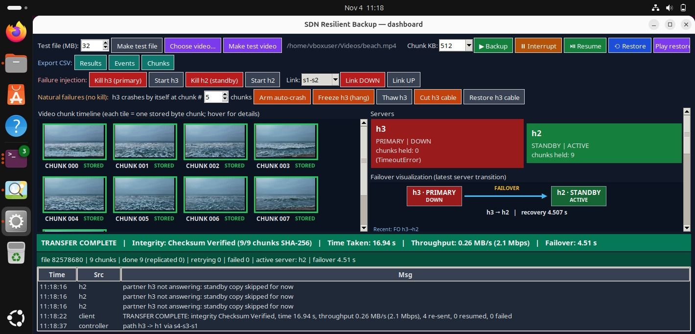

**SDN-Aware Resilient Distributed Backup System**

Chunked TCP backups that survive server crashes, frozen servers, cut cables and failed links. A POX SDN controller picks and repairs network paths; a standby server takes over automatically 
________________________________________

**Table of contents**
1.	Overview
2.	Highlights
3.	Architecture
4.	How it works
5.	Failure handling
6.	The SDN controller
7.	The dashboard
8.	Requirements covered
9.	Getting started
10.	Demo scenarios
11.	Results and evaluation
12.	Project structure
13.	Testing
14.	Design decisions, limitations and future work
15.	Team and contrubutions
16.	vedio demo
________________________________________
**1. Overview**

**Problem.**
A client must back up files to remote servers over TCP. Servers crash, cables are cut and links fail. A simple backup tool then stops halfway, and nobody knows whether the data on the server is intact.

**Our solution.**
The file is split into chunks and sent over TCP to a primary server (h3) that copies every chunk to a standby server (h2) before acknowledging it. Every chunk carries a SHA-256. The network is a Mininet topology with two paths between the client and the primary, managed by a POX SDN controller that routes traffic by link utilisation and repairs paths when a link fails. If anything breaks, the client switches to the standby on its own, re-sends only what was lost, and at the end verifies every chunk against what the servers really hold.

**Course project, Computer Networks (SDN). Problem statement:**

 **Distributed Backup System: clients transfer files to backup servers through TCP; SDN dynamically selects suitable paths and supports recovery during failures.**
 
**Basic backup tool**	                     **This project**
One server, one path	        Primary + standby server, two network paths
A failure stops the transfer	Automatic failover to the standby; only lost chunks are re-sent
Restart from zero after an 
interruption	                Resume: only missing chunks are sent
"Done" with no proof	        Per-chunk SHA-256, then Checksum Verified against the servers
Static routing	                SDN controller routes by utilisation and reroutes on failure
Black box	                    Live dashboard: one tile per chunk, servers, topology, throughput,event log

________________________________________
**2. Highlights**
	
Automatic failover h3 to h2	     Detected by heartbeat, by connection errors, and by the  
                                 controller  reporting "no path". Stuck chunks are aborted and re-sent.
Natural failures, not only Kill	 h3 crashes by itself, h3 freezes (hangs), h3 cable cut, both pathscut. Kill h3 stays as the challenging scenario.
Interrupt and Resume	         Stop a transfer halfway and continue later; only missing chunks  are sent.
Integrity you can see	         TRANSFER COMPLETE / Integrity: Checksum Verified / Time Taken /Throughput in Mininet and in the dashboard.
App and SDN talk to each other	 The client asks the controller over a UNIX socket for the path and reachability of each server.
Any file, including video	     Chunked as raw bytes; the restored video keeps its extension and plays.
Dashboard	                     One tile per chunk with hover details, PRIMARY / STANDBY status,live topology, throughput chart, event log.
CSV export	                     Results, events and the chunk map, ready for graphs in the report.
________________________________________

**3. Architecture**
Architecture
Component        	File	              Runs on	                           Job
Backup client	  backup/client.py  	Mininet host h1	      Chunk, send in parallel, detect failures, fail over, resume, verify, restore
Backup server	  backup/server.py	    h3 (primary) and      Verify and store chunks, replicate 
                                        h2 (standby)	      to the partner, re-sync after a restart
SDN controller	  controller            POX (OpenFlow 1.0)
                  /multipath_controller.py		              Discover links, compute and install paths, reroute, answer path queries
Topology	      topology/topology.py	Mininet            	  4 switches, 3 hosts, link bandwidth and delay, failure injection, result box
Dashboard	      dashboard/app.py, model.py Ubuntu desktop	  Visualise everything, send commands

**Topology**
h1 is the client (10.0.0.1), h3 the primary (10.0.0.3), h2 the standby (10.0.0.2). Path A is s1-s2-s4 (5 ms links), path B is s1-s3-s4 (15 ms links). All inter-switch links are limited to 10 Mbit.
              s2
             /  \
   h1 --- s1      s4 --- h3   (primary)
             \  /
              s3
              |
              h2              (standby)
Full design document: docs/ARCHITECTURE.md.
________________________________________

**4. How it works**

1.	Chunk.
     The file is cut into fixed-size chunks (128 KB to 1 MB) and each gets a SHA-256. file_id is the first 16 hex characters of the whole-file SHA-256.
2.	Send.
     Worker threads send chunks in parallel over TCP. The primary recomputes the hash; a mismatch is rejected and the client retries.
3.	Replicate.
     The primary stores the chunk, copies it to the standby, and only then acknowledges. An acknowledged chunk therefore survives the loss of the primary.
4.	Verify.
     After the last chunk the client asks every server what it holds and compares each chunk's SHA-256 with the source file. All equal: Checksum Verified.
5.	Restore.
     Chunks are fetched from any server that has them, each hash is checked, the file is rebuilt and its whole-file SHA-256 compared with the original.

 When a transfer ends, the Mininet terminal prints:

	
==================================================================
                        TRANSFER COMPLETE
==================================================================
 File:        clip.mp4
 Size:        6.00 MB in 48 chunks of 128 KB
 Integrity:   Checksum Verified - all 48 chunks match their SHA-256 on the servers
 Time Taken:  0.78 seconds
 Throughput:  7.67 MB/s (64.4 Mbps)
 Stored on:   h2: 48 chunks, h3: 48 chunks
 Failover:    none needed
 Resumed:     22 chunks were already safe on the servers, only 26 chunks (3.25 MB) sent now
==================================================================
_______________________________________
## Project screenshots

**5. Failure handling**

Failure	                         How it is detected	                      What happens
h3 killed or crashed	        Connection refused or reset         	h3 marked DOWN, chunk retried on h2
h3 frozen (alive but silent)	3 missed heartbeats (0.5 s apart)	    h3 marked DOWN, in-flight sockets aborted so chunks are not stuck for the full timeout, retried on h2
h3 cable cut	                Heartbeat lost	                        Same as above
Both paths to h3 cut	        Controller socket answers "no path"	    Immediate failover, no timeout wait; stays on h2 until a path returns
Path A link down	            POX link-down event	                    Flows on the link deleted, path B installed, reroute time logged; TCP carries on
Congested path	                Port statistics above 80%	            Flow moved to the freer path (no flapping when both are busy)
                                while the alternative is below 50%
Client interrupted or crashed                                           Stored chunks stay on the servers; Resume sends only the rest
h3 restarts		                                                        Pulls the chunks it missed from h2 (re-sync)
Partner unreachable	            Replication times out (2 s)          	Server stops trying for 3 s (circuit breaker) so the transfer is not slowed down
________________________________________

**6. The SDN controller**

controller/multipath_controller.py is a POX component using OpenFlow 1.0.

•	Discovery. openflow.discovery supplies the switch links; openflow.spanning_tree keeps flooding loop-free for ARP on the meshed topology. Unicast routing is done by this     component.
•	Utilisation. Port statistics are polled every 2 s; utilisation = bits per second / link capacity.
•	Path choice. Dijkstra with link cost 1 + 10 x utilisation: an idle fast path wins, a busy one becomes expensive.
•	Flows. For each host pair, entries (match on source and destination MAC, 10 s idle timeout) are installed on every switch of the path, in both directions.
•	Reroute. On link-down, only flows that used the link are deleted; the next packet triggers a new path, and the time from link-down to the new path is logged in              milliseconds.
•	Socket API. A UNIX socket (/tmp/sdnbackup/sdn.sock, one JSON line each way). reach returns the path, hop count and busiest-link utilisation to each server, or               reachable: false. status returns links and utilisation. Mininet hosts share the filesystem with the controller, so h1 reaches it with no network configuration.
________________________________________

**7. The dashboard**

dashboard/app.py (Tkinter) tails the shared event log and updates only what changed, so thousands of chunks stay smooth.

**Colour	Chunk state**
Grey	    Pending
Yellow   	Sending
Orange  	Retrying
Green	    Stored on one server
Teal	    Stored on both servers (replicated)
Red     	Failed
Blue	    Verified during restore

•	Chunk grid: one tile per chunk, hover for chunk number, size, servers holding it, retries and SHA-256.
•	Server cards: PRIMARY / STANDBY, UP / DOWN / ACTIVE, chunks held.
•	Topology: link utilisation colours, active path highlighted, failed links in red.
•	Throughput chart and a live event log (time, source, message).
•	Result banner: the same facts as the Mininet box (Checksum Verified, time taken, throughput).
•	Buttons: Backup, Interrupt, Resume, Restore, Play restored, Kill h3, Start h3/h2, Link DOWN / UP, Freeze h3, Arm auto-crash, Cut h3 cable, Export CSV (results, events,      chunks).
________________________________________

**8. Requirements covered**
Requirement	                                 How this project meets it          	                         Where
Implement TCP file transfer 	        TCP sockets with a small length-prefixed JSON protocol	             backup/
Divide files into chunks	            Fixed-size chunks, sent in parallel             				   	 backup/client.py
Use checksums for integrity   	        SHA-256 per chunk, re-checked against the servers after upload,
                                        whole-file check on restore	                                         backup/
Support interrupted-transfer recovery	Interrupt / Resume; stored chunks are kept and skipped             	 backup/client.py
Use multiple backup servers	            Primary h3 + standby h2 with replication and re-sync	             backup/server.py
Select suitable network paths	        POX Dijkstra on utilisation-aware link cost                     	 controller/
Simulate path failure               	Link DOWN, cable cut, frozen server, crashes; controller reroutes	 controller/, topology/
Measure throughput and recovery time	Result box, banner, failover and reroute times, CSV export	         backup/, dashboard/
________________________________________

**9. Getting started**
Prerequisites: Ubuntu with Mininet, Open vSwitch, Python 3 with Tkinter, POX.
sudo apt update
sudo apt install -y mininet openvswitch-switch python3-tk ffmpeg git
git clone https://github.com/noxrepo/pox ~/pox
git clone <this repository> ~/sdn-backup
sudo chmod -R 777 /tmp/sdnbackup 2>/dev/null || true   # shared log folder (Mininet runs as root)  

**Run (three terminals, in this order):**
# 1. controller
cp ~/sdn-backup/controller/multipath_controller.py ~/pox/ext/
cd ~/pox && ./pox.py log.level --INFO openflow.discovery openflow.spanning_tree multipath_controller

# 2. Mininet topology (wait for POX; it prints "ready" and gives a mininet> prompt)
sudo mn -c
sudo python3 ~/sdn-backup/topology/topology.py --delay 0.02

# 3. dashboard
python3 ~/sdn-backup/dashboard/app.py --replay
./run_all.sh ~/pox starts all three in one command.
In the dashboard: Make test file (or Choose video... / Make test video), then Backup.

Quick demo without Mininet (two servers on one machine, primary killed mid-backup, restore, hash comparison):
python3 local_demo.py
Command-line equivalents from the Mininet prompt: h1 python3 backup/client.py backup FILE --servers h3=10.0.0.3:9000,h2=10.0.0.2:9000, h1 python3 backup/client.py restore FILE_ID OUT --servers ..., link s1 s2 down, iperf.
________________________________________

**10. Demo scenarios**
Scenario                                  	How                                    	Expected result
Normal backup	                           Backup	                            Tiles turn teal; box says Checksum Verified
Kill h3 (challenging scenario)	       Backup, then Kill h3 (primary)	        Client switches to h2; backup completes; hash matches
h3 crashes by itself	               Arm auto-crash (N chunks), then Backup	h3 exits on its own; client switches to h2 with no button pressed
h3 freezes	                           Freeze h3 (hang) during a backup	        Heartbeat lost; stuck chunks aborted; h2 takes over in about 2 s
h3 cable cut	                       Cut h3 cable                          	Heartbeat lost; client switches to h2
Path A fails                       	   Link s1-s2 DOWN							POX reroutes over s1-s3-s4; reroute time in ms
Both paths to h3 fail	               Link DOWN on s2-s4 and s3-s4	            Controller reports "no path to h3"; client switches to h2 at once
Interrupted transfer	               Interrupt, then Resume	                Only missing chunks are sent; box shows how many were already safe
Restore            					   Restore, then Play restored	 			Whole-file SHA-256 matches; the video plays
________________________________________

**11. Results and evaluation**
Measured results on the Mininet topology (throughput, failover time, reroute time, chunks re-sent, comparisons) are in docs/RESULTS.md, exported with the dashboard's Export CSV buttons.
Automated test runs on one machine (loopback, no bandwidth limits, so these show behaviour and not network speed):

 Test															Outcome
Primary killed mid-backup	               		 Backup completes on h2; restored file hash identical
h3 crashes by itself (no kill command)	   		 Client switched to h2 in about 0.06 s; restored hash identical
h3 frozen (alive, silent)	             	     Heartbeat lost, in-flight chunks aborted, h2 took over in about 2.1 s; hash identical
Client killed mid-transfer, then rerun	   		 Chunks already stored were skipped, not re-sent (for example 14 of 64); hash identical
Both servers down for 3 s	              		 Backup completes after they return; hash identical
Controller says "no path to h3" while h3 is alive	Client fails over to h2 without flapping; hash identical
Corrupted chunk                            		Rejected by the server, never stored
________________________________________

**12. Project structure**

sdn-backup/
├── backup/
│   ├── client.py        chunking, parallel upload, heartbeat, failover, resume, verify, restore
│   ├── server.py        verify and store chunks, replicate, re-sync, self-crash for demos
│   └── common.py        protocol framing, SHA-256, event log, CSV helpers
├── controller/
│   └── multipath_controller.py     POX component: discovery, Dijkstra, flows, reroute, socket API
├── topology/
│   └── topology.py      Mininet topology, failure injection, result box in the terminal
├── dashboard/
│   ├── app.py           Tkinter dashboard
│   └── model.py         event model (no Tk, unit-testable)
├── tests/               test_core.py  test_controller_logic.py  test_model.py
├── docs/                ARCHITECTURE.md  RESULTS.md  DEMO_SCRIPT.md  diagrams  screenshots/  video/
├── local_demo.py        whole scenario on one machine, no Mininet
├── run_all.sh           starts POX + dashboard + Mininet
├── CONTRIBUTIONS.md
└── README.md
________________________________________

**13. Testing**
python3 tests/test_core.py              # backup, resume, checksum rejection, outage recovery, controller-socket failover,
                                        # h3 crashes by itself, h3 freezes (local servers, no Mininet)
python3 tests/test_controller_logic.py  # controller routing, reroute, congestion, socket API (POX API stubbed)
python3 tests/test_model.py FILE        # dashboard model, replaying an event file
________________________________________

**14. Design decisions, limitations and future work**

Design decision                                                            	Reason
Primary replicates to standby before ACK	            An acknowledged chunk survives the loss of the primary
Re-verify against the servers after upload				Detects lost or changed chunks, not only transmission errors
Resume compares hashes on the servers, not local state	Works even if the client crashed or its metadata is stale
Abort in-flight sockets on failover	               		A frozen server would otherwise hold chunks until the 10 s timeout
Controller reachability feeds the client				Real app-to-SDN integration
UNIX socket for the controller API						Works from inside a Mininet host with no extra links

**Limitations**

•	POX supports OpenFlow 1.0 only, so there is no QoS (meters/groups).
•	Failover is decided by the client (heartbeat, errors, controller answer); the controller does not rewrite traffic to a virtual IP.
•	Path cost uses hop count and link utilisation; link delay is not measured.
•	The chunk map is a JSON file on the client host.
•	No encryption or de-duplication of chunks.

**Future work:**
virtual-IP failover handled entirely by the controller, QoS for backup traffic, encryption per chunk, de-duplication by chunk hash, more than two servers with a configurable replication factor.
________________________________________

**15. Team members and Contributions**
CONTRIBUTIONS.md

PALLAVI  H S
- Backup client implementation
- Chunking and resume functionality
- Testing and documentation

PRAKRUTHI R
- Dashboard development
- Visualization and CSV export
- UI testing

NARUN PATIL
- SDN controller implementation
- Mininet topology setup
- Failure recovery mechanisms

  ## final demo
 [▶ Watch Final Demo Video](./final-demo.mp4)
  

